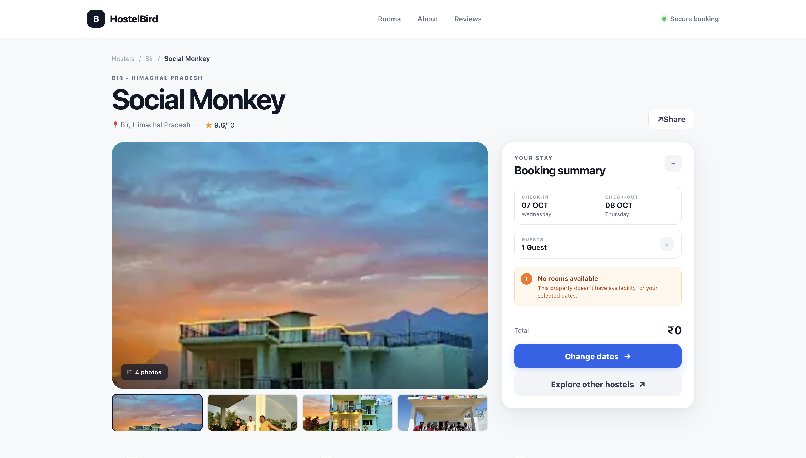
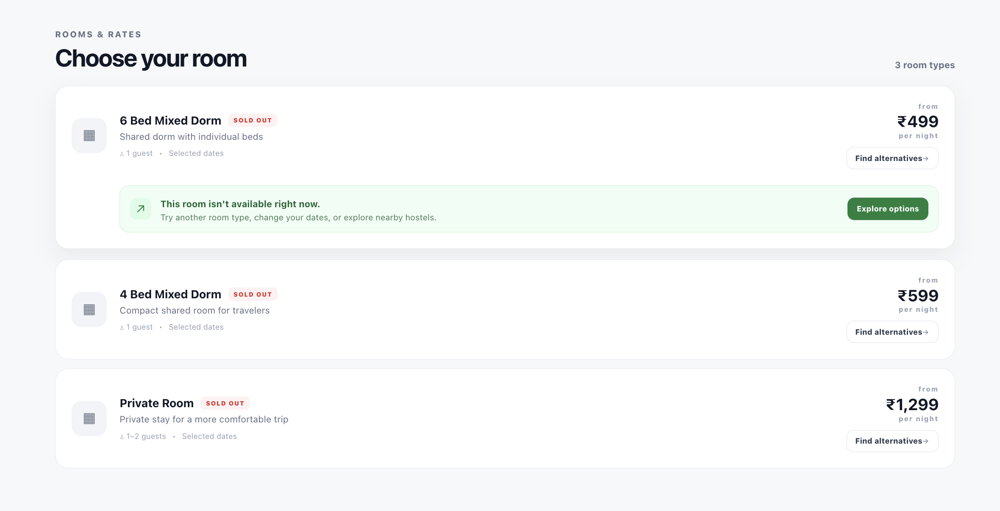
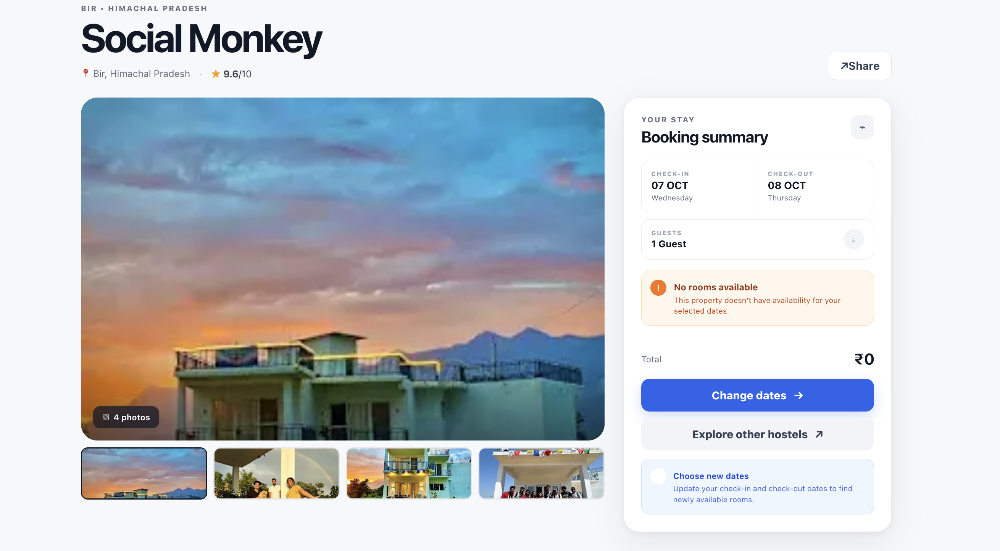
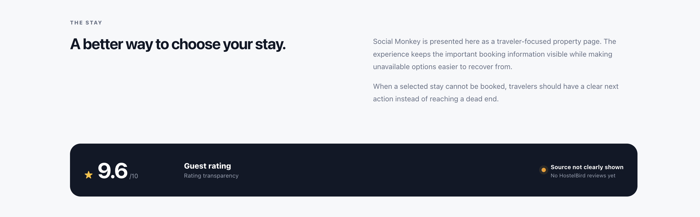
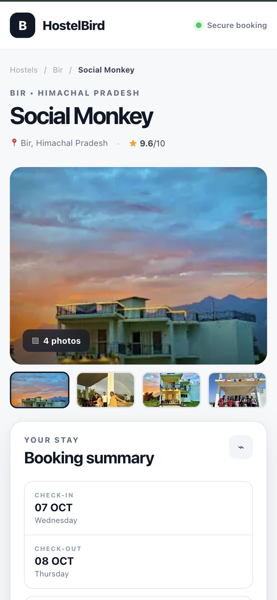
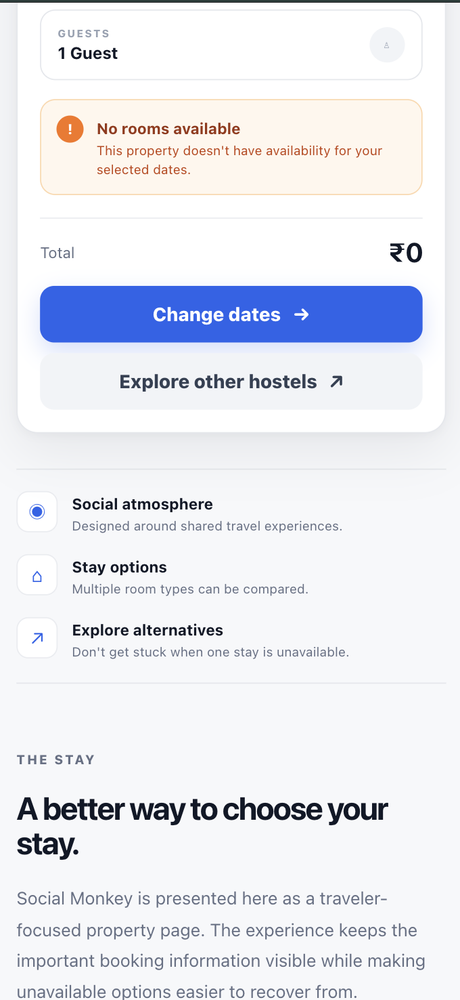
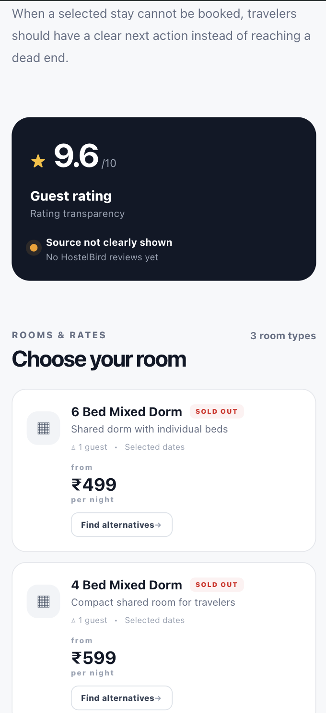
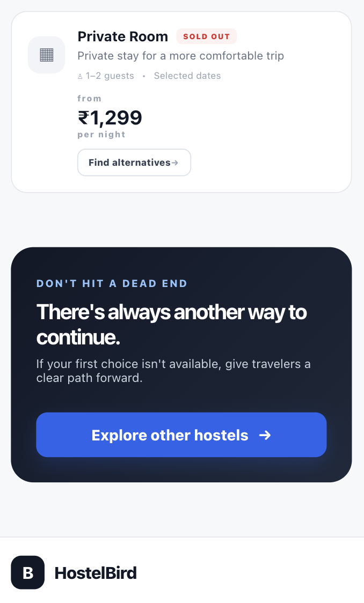

# HostelBird — Build & Break Hackathon 2026

## Build It. Break It. Ship It.

A frontend UX improvement prototype created for the **HostelBird Build & Break Hackathon**.

The goal of this project was to examine the hostel-booking experience from a traveler's perspective, identify points where the booking journey could become unclear or reach a dead end, and design clearer recovery paths.

---

## 1. Project Overview

When a traveler searches for a hostel, an unavailable property or room should not leave the user wondering what to do next.

For this project, I focused on improving the experience around:

- Property-level unavailability
- Sold-out rooms
- Recovery actions
- Rating/review transparency
- Responsive mobile experience

The prototype redesign keeps important booking information visible while providing clear next actions when the selected option cannot be booked.

---

# 2. Problems Identified

## Problem 1 — No Availability Should Not Become a Dead End

During testing, a property can reach a state where there are no rooms available for the selected dates.

The important UX question is:

> What should the traveler do next?

Instead of ending the journey at an unavailable-property state, the redesigned experience provides two clear recovery options:

- **Change dates**
- **Explore other hostels**

This gives the traveler an immediate next step instead of forcing them to figure out how to continue.

---

## Problem 2 — Sold-Out Rooms Need a Recovery Path

A room that cannot be booked should communicate its unavailable state clearly.

In the prototype, unavailable rooms are explicitly marked:

**SOLD OUT**

The room also provides a:

**Find alternatives**

action.

When the action is selected, an inline recovery message appears within the room card explaining that the traveler can:

- Try another room type
- Change the dates
- Explore nearby hostels

This keeps the recovery action close to the problem instead of sending the user to an unrelated part of the page.

---

## Problem 3 — Rating / Review Information Should Be Transparent

The rating section was redesigned to make the available rating information visually clear while also highlighting the transparency of its source.

The prototype separates:

- Rating value
- Guest rating label
- Rating transparency
- Source visibility
- Review availability

The goal is to reduce ambiguity about what the displayed rating represents when the source is not clearly presented.

---

# 3. Solution

The prototype introduces a redesigned property page focused on **clarity, recovery, and responsive usability**.

## Main Improvements

### 1. Clear Availability State

The booking panel clearly communicates:

> No rooms available

Instead of leaving the user at the unavailable state, it immediately provides recovery actions.

---

### 2. Change-Date Recovery

The **Change dates** button provides an explanatory state:

> Choose new dates

The message explains that updating the check-in and check-out dates can help the traveler look for newly available rooms.

---

### 3. Alternative-Hostel Recovery

The **Explore other hostels** action provides another route when the selected property cannot accommodate the traveler.

The prototype makes this recovery action available from relevant points in the experience.

---

### 4. Sold-Out Room Handling

Unavailable rooms are visually identified using a **SOLD OUT** badge.

The user can select:

> Find alternatives

The alternative message is displayed directly within the selected room card.

---

### 5. Rating Transparency

The rating section uses a dedicated visual block to distinguish:

- Rating score
- Guest rating
- Rating transparency
- Source visibility
- Review availability

---

### 6. Responsive Mobile Experience

The redesigned page was tested on a mobile viewport.

The layout adapts by:

- Stacking the booking card below the gallery
- Converting multi-column sections into vertical layouts
- Making buttons easier to tap
- Keeping room information readable
- Keeping recovery actions visible
- Preventing horizontal overflow

---

# 4. Key UX Decisions

## Keep Recovery Actions Close to the Problem

If a room is sold out, the user should not have to search somewhere else for what to do next.

Therefore, the recovery action is placed directly inside the room card.

---

## Make Unavailable States Obvious

Instead of allowing unavailable options to look like normal bookable options, the prototype uses a clear:

**SOLD OUT**

indicator.

---

## Preserve the Booking Context

The booking summary remains visible near the property gallery on desktop.

This keeps important information such as:

- Check-in
- Check-out
- Guests
- Availability
- Total
- Recovery actions

together.

---

## Use Clear Visual Hierarchy

The design uses different visual treatments for:

- Primary actions
- Secondary actions
- Warnings
- Recovery messages
- Informational sections

This allows users to understand the next step quickly.

---

## Design for Both Desktop and Mobile

The booking flow is not treated as desktop-only.

The same recovery concepts are maintained on smaller screens while the layout changes to a single-column experience.

---

# 5. Main User Flow

The redesigned experience follows this flow:

```text
Open Property
      ↓
View Property Details
      ↓
Select Dates / Guests
      ↓
Check Availability
      ↓
┌───────────────────────┐
│ Availability exists?  │
└───────────┬───────────┘
            │
      ┌─────┴─────┐
      │           │
     YES          NO
      │           │
      ↓           ↓
 Continue    Recovery Options
 Booking          │
                  ├── Change Dates
                  │
                  └── Explore
                      Other Hostels
```

### Room-Level Recovery

```text
View Room
    ↓
Room Available?
    │
 ┌──┴───┐
YES     NO
 │       │
 ↓       ↓
Book    SOLD OUT
         ↓
 Find Alternatives
         ↓
 ┌───────┼──────────┐
 ↓       ↓          ↓
Another  Change    Other
Room     Dates     Hostels
```

---

# 6. Screenshots

## Main Desktop Experience

The main property page shows the redesigned property header, gallery, booking summary, availability state, and recovery actions.



---

## Sold-Out Room Recovery

A sold-out room provides an inline alternative path instead of ending the room-selection journey.



---

## Change-Date Recovery

The booking panel provides an explanatory state after selecting the change-date action.



---

## Rating Transparency

The rating section separates the rating information from the source/review availability information.



---

## Mobile Experience

The redesigned page was also tested using a mobile viewport.

### Mobile — Property and Booking



### Mobile — Booking and Quick Information



### Mobile — Rating and Rooms



### Mobile — Final Recovery CTA



---

# 7. Technology Stack

- React
- Vite
- JavaScript
- CSS
- Responsive Web Design

---

# 8. Project Structure

```text
HostelBird-Hackathon/
│
├── public/
│   ├── social-monkey.jpg
│   ├── social-monkey-2.jpg
│   ├── social-monkey-3.jpg
│   └── social-monkey-4.jpg
│
├── screenshots/
│   ├── 01-main-desktop.png
│   ├── 02-room-recovery.png
│   ├── 03-change-dates.png
│   ├── 04-rating-transparency.png
│   ├── 05-mobile-01.png
│   ├── 05-mobile-02.png
│   ├── 05-mobile-03.png
│   └── 05-mobile-04.png
│
├── src/
│   ├── components/
│   │   └── PropertyPage.jsx
│   │
│   ├── App.jsx
│   ├── index.css
│   └── ...
│
├── package.json
├── package-lock.json
└── README.md
```

---

# 9. How to Run the Project

## Prerequisites

Make sure Node.js and npm are installed.

Check the installed versions:

```bash
node -v
npm -v
```

## Install Dependencies

From the project directory:

```bash
npm install
```

## Start Development Server

Run:

```bash
npm run dev
```

Vite will provide a local development URL, usually similar to:

```text
http://localhost:5173
```

Open the URL in a browser.

---

# 10. Testing Performed

The prototype was manually tested for the following interactions and layouts.

## Gallery

- Tested thumbnail selection
- Confirmed that the main property image changes when thumbnails are selected

## Availability Recovery

- Tested the **Change dates** action
- Confirmed that the explanatory recovery message appears

## Alternative Hostels

- Tested the **Explore other hostels** action
- Confirmed that the alternative-hostel recovery state appears

## Sold-Out Rooms

- Tested the **Find alternatives** action
- Confirmed that the recovery message appears inside the selected room card

## Desktop

Tested:

- Property layout
- Gallery
- Booking summary
- Room cards
- Recovery states
- Rating section

## Mobile

Tested:

- Header
- Property information
- Gallery
- Booking summary
- Availability warning
- Quick information
- About section
- Rating section
- Room cards
- Final CTA
- Footer

The mobile layout was checked for horizontal overflow and content fitting.

---

# 11. Prototype Scope

This project is a **frontend UX prototype**.

The goal is to demonstrate the proposed user experience and interaction improvements rather than implement a complete production booking backend.

The following areas are represented as prototype interactions:

- Availability changes
- Date changes
- Alternative-hostel navigation
- Booking actions
- Review data
- Live room inventory

A production implementation would connect these interactions to the appropriate HostelBird backend, availability, review, and booking systems.

---

# 12. Future Improvements

If this prototype were taken toward production, the next improvements could include:

### Live Availability

Connect property and room states to real-time inventory.

### Functional Date Selection

Allow travelers to change check-in and check-out dates directly within the booking flow.

### Nearby Hostel Recommendations

Use location and availability data to recommend alternative properties.

### Real Review Integration

Connect rating information to a clearly identified review source.

### Booking Integration

Connect the redesigned UI to the existing booking and payment flow.

### Analytics

Measure:

- Recovery-action clicks
- Date changes
- Alternative-hostel exploration
- Abandoned booking attempts
- Conversion after recovery

These metrics could help determine whether the redesigned flow reduces booking dead ends.

---

# 13. Design Principles

The prototype follows four main principles:

### CLARITY

Make unavailable states obvious.

### RECOVERY

Always provide a reasonable next step.

### CONTEXT

Keep important booking information together.

### RESPONSIVENESS

Make the experience work across desktop and mobile.

---

# 14. Conclusion

The main goal of this project was not simply to redesign the visual appearance of a property page.

The focus was on improving what happens when the user's first choice does not work.

The redesigned experience makes unavailable properties and rooms clearer while providing multiple recovery paths such as:

- Changing dates
- Trying another room
- Exploring other hostels

This approach aims to reduce booking dead ends and help travelers continue their journey with less confusion.

---

## Hackathon

**Build and Break Hackathon — HostelBird**

**Theme:** Build It. Break It. Ship It.

**Project:** HostelBird UX Improvement Prototype
